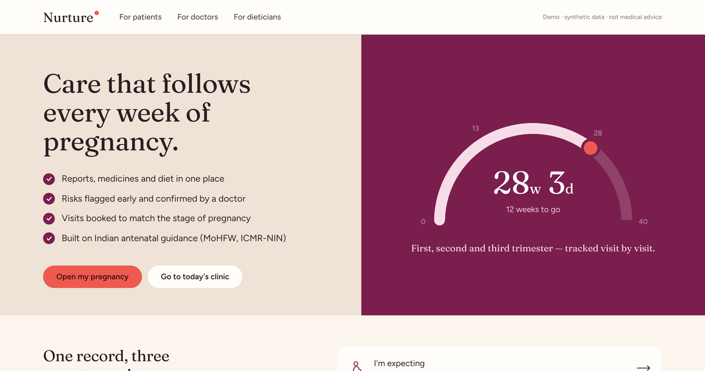
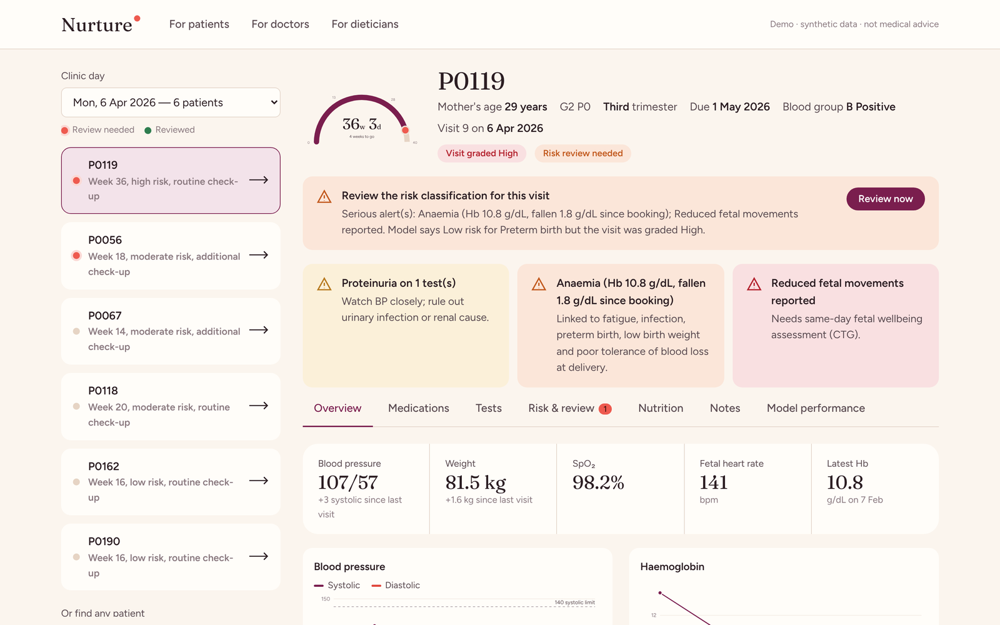
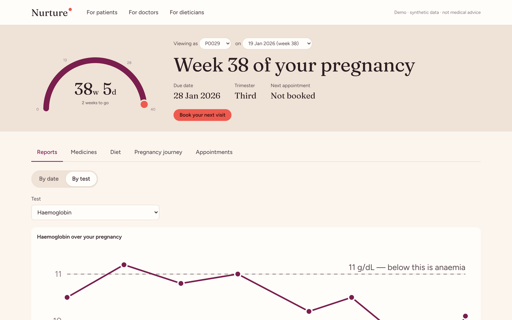
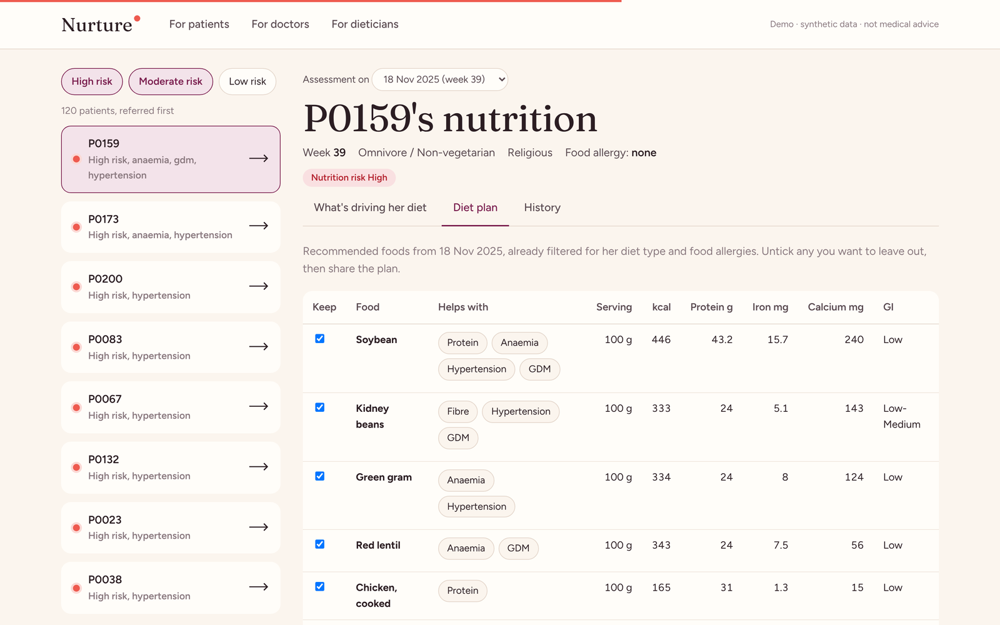
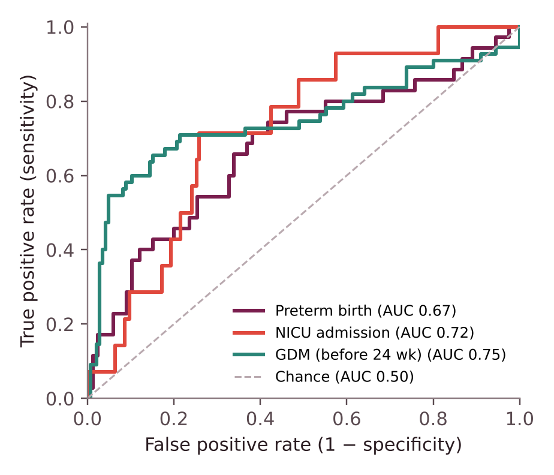
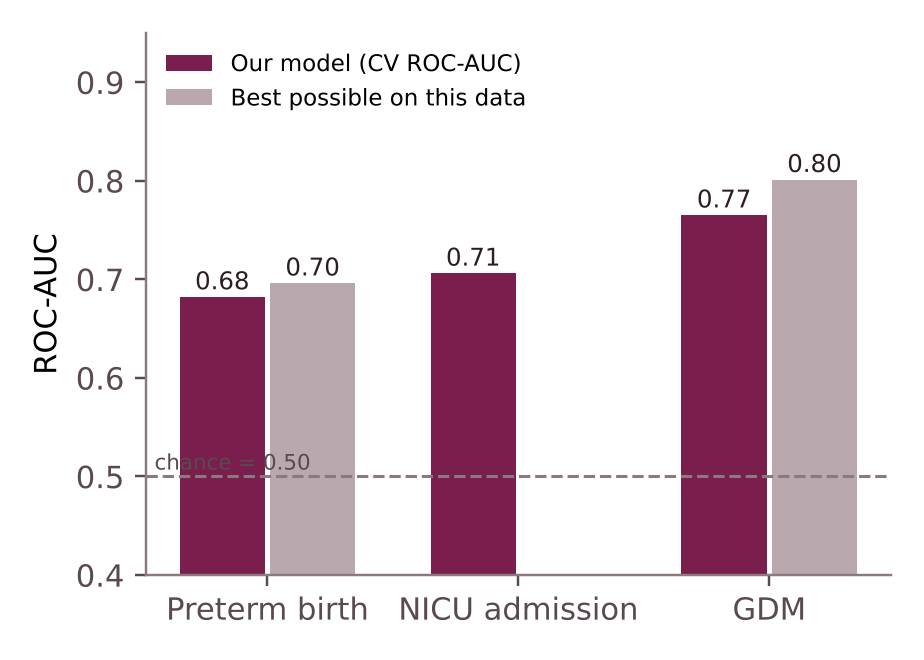
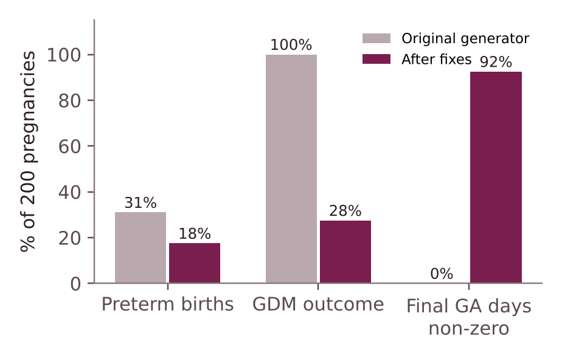
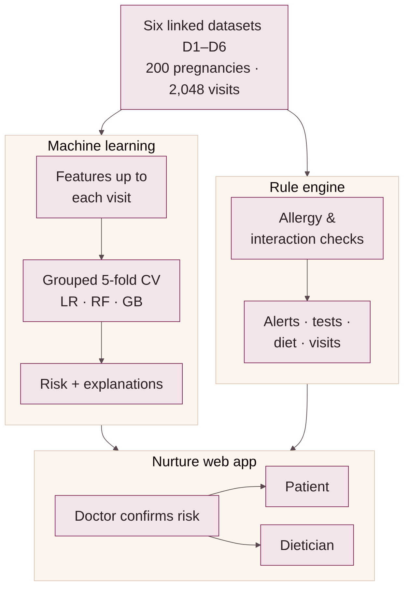

# Nurture — Maternal Health Decision Support System

**Live demo: https://nurture-e2e1.onrender.com** — free hosting, so the first visit after a quiet spell takes about a minute to wake up.

Nurture brings a pregnant woman's visits, lab reports, medicines and diet plans into one place, predicts risks early,
checks every prescription for safety, and shows each person what they need: the **patient**, the **doctor** and the
**dietician**. It is built on six linked synthetic datasets describing 200 Indian pregnancies.



> Course project — B.Tech Artificial Intelligence & Data Science, Amrita Vishwa Vidyapeetham, Delhi NCR (2026).
> Synthetic data only. Decision support for learning purposes, not medical advice.

## What it does

| View | Highlights |
|---|---|
| **Doctor** | Today's clinic list with review flags · alerts (BP, anaemia, proteinuria, reduced fetal movement) · current and suggested medicines with allergy and interaction checks · tests due or overdue · ML risk with explanations · confirm or override each risk with a reason |
| **Patient** | 40-week pregnancy arc · reports by date or by test with trends · medicines with how to take them · diet plan · appointment booking with danger-sign triage |
| **Dietician** | Worklist sorted by nutrition risk · Hb, glucose, BP and weight-gain drivers · editable food plan shared with the patient |

| Doctor | Patient | Dietician |
|---|---|---|
|  |  |  |

## Machine learning

Three risk models are trained on **visit-level features that use only data available up to each visit**, so no
future information leaks into a prediction.

| Outcome | Best model | ROC-AUC | Best possible on this data | Balanced accuracy |
|---|---|---|---|---|
| Preterm birth (35/200) | Random Forest | 0.682 | 0.696 | 0.65 |
| NICU admission (14/200) | Random Forest | 0.706 | — | 0.72 |
| Gestational diabetes, before the 24-week test (55/200) | Logistic Regression | 0.765 | 0.801 | 0.74 |

- 49 features per visit: baseline history, vitals, cumulative visit history, labs so far, medicines so far.
- 5-fold cross-validation **grouped by pregnancy**; every patient is scored by a model that never saw her.
- **Ceiling check:** scoring each pregnancy with the data generator's own true probabilities gives the best
  achievable ROC-AUC. The models are within 0.04 of it, so higher scores would mean leakage, not skill.
- Accuracy alone is misleading for rare outcomes (always predicting "no" scores 83–93%), so balanced
  accuracy, sensitivity and specificity are reported.
- The doctor confirms or changes every risk band; decisions are logged with the reason.

<p align="center"> </p>

## Data quality fixes

Auditing the original pipeline found seven defects, all fixed and regenerated with the same random seed:

- Every pregnancy was labelled gestational diabetes (GDM was set when a screening test merely existed) → now 55/200.
- Preterm births were inflated to 31% because delivery was taken from the last check-up → now 17.5%.
- Diet type changed between visits ("omnivore" did not match "Omnivorous").
- Lab values were destroyed by label encoding; text columns were parsed as dates; "None" was read as missing.

<p align="center"></p>

## Architecture

<p align="center"></p>

- **Back end:** Python, FastAPI, pandas, scikit-learn. Data and models load once; all risk scores are pre-computed.
- **Front end:** plain HTML, CSS and JavaScript with SVG charts — one API call per screen (10–130 ms).
- **Rule engine:** allergy crosswalk, 13 drug-interaction rules, pregnancy-avoid flags, alerts, test schedule,
  IOM weight-gain ranges, and visit intervals by gestational week and risk.

## Run it locally

```bash
python -m pip install -r requirements.txt
python train_models.py   # about a minute
python server.py         # opens http://localhost:8000
```

## Deploy

The repository deploys to [Render](https://render.com) for free using `render.yaml`
(New → Blueprint → this repository). See the deployment notes further down for settings and free-tier limits.

## Project structure

```
server.py              FastAPI web server
static/                front end (index.html, app.css, app.js, fonts)
mh/                    data loading, features, models, clinical rules, reviews, appointments
train_models.py        trains the three risk models
datasets/              six linked synthetic datasets (D1–D6)
dataset_generation/    dataset generators and preprocessing (fixed versions)
docs/                  project report, slides, figures and screenshots
render.yaml            free Render deployment
```

## Documents

- [Project report (IEEE format, PDF)](docs/Nurture_Project_Report.pdf)
- [Mid-term presentation (PDF)](docs/Nurture_MTE_Presentation.pdf)

## Team

Tarun Sai Kuna · Joy Soni · Arnav Patel · Dhriti Sharma — Department of Artificial Intelligence & Data Science,
Amrita Vishwa Vidyapeetham, Delhi NCR.

## Deployment notes (Render free tier)

Build command `pip install -r requirements.txt && python train_models.py`, start command `python server.py`,
environment variables `PYTHON_VERSION=3.12.7` and `NURTURE_WARM=0`. The free instance has 512 MB RAM (the app
uses about 250 MB), sleeps after 15 minutes without visitors, and resets bookings, reviews and notes on every
restart because they are stored in files. There is no login, so only synthetic data should be used.
